<div align="center">

<a href="https://limitedio.github.io/PipeTv/">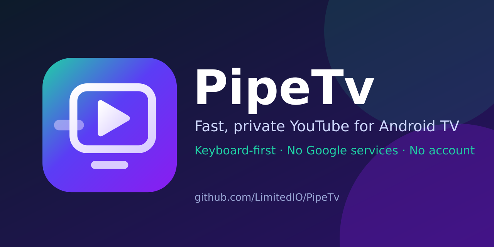</a>

**YouTube on your TV, like it used to feel.**
A fast, private, remote-first YouTube client for Android TV, Google TV and Fire TV.
No ads · no account · no Google services · SponsorBlock built in

[](https://github.com/LimitedIO/PipeTv/releases/latest) [](https://github.com/LimitedIO/PipeTv/releases) [](#) [](https://limitedio.github.io/PipeTv/)

**[⬇ Download the APK](https://github.com/LimitedIO/PipeTv/releases/latest)** · **[▶ Watch the full tour](https://limitedio.github.io/PipeTv/#tour)** · **[★ Star the repo](https://github.com/LimitedIO/PipeTv/stargazers)**

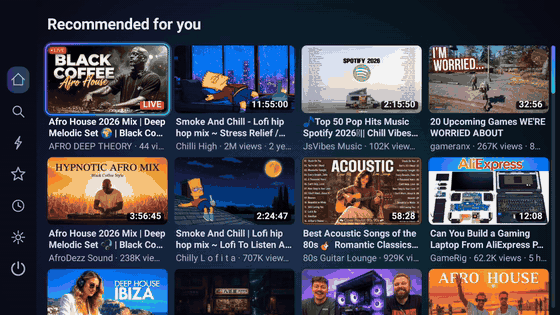

</div>

## Screenshots
| | | |
|---|---|---|
| 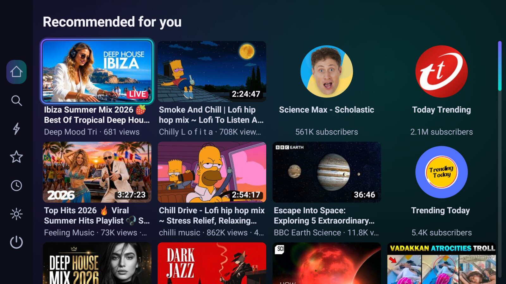 | 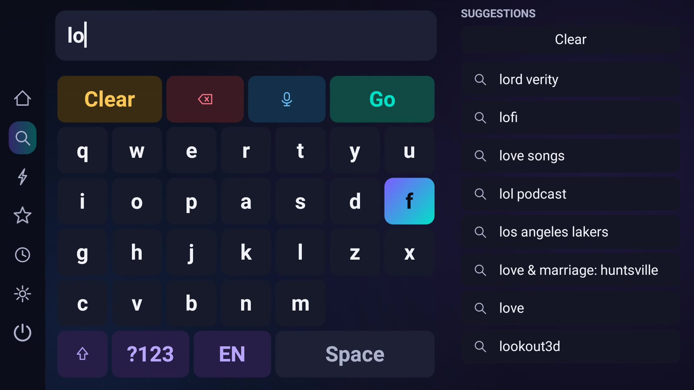 | 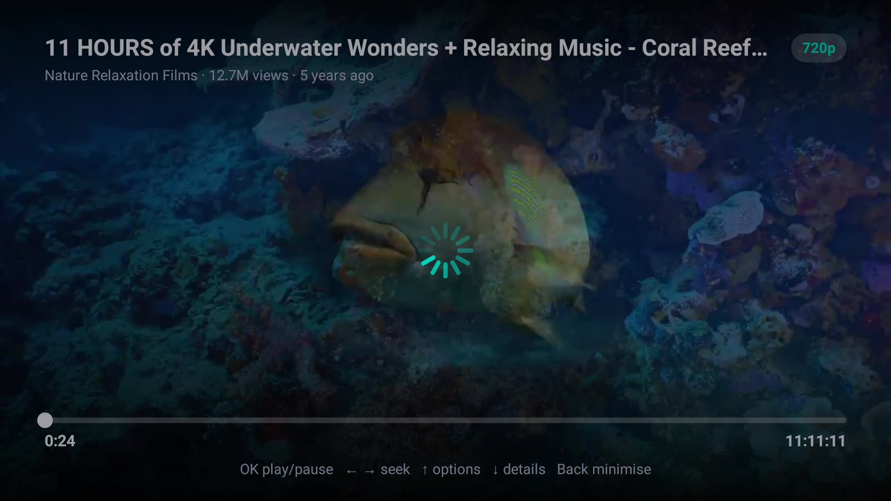 |
| Instant home feed | Remote keyboard, live suggestions | Fullscreen playback |
| 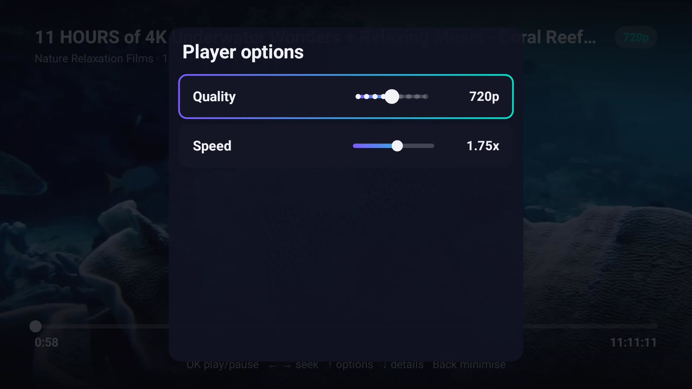 | 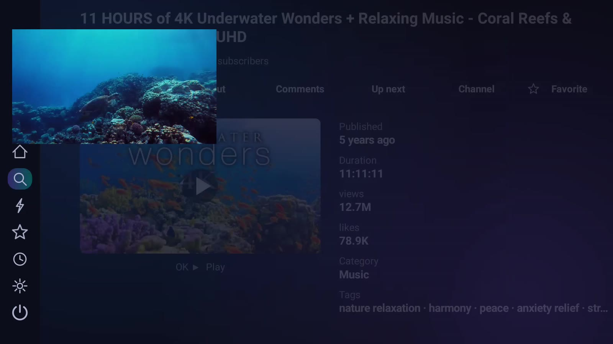 | 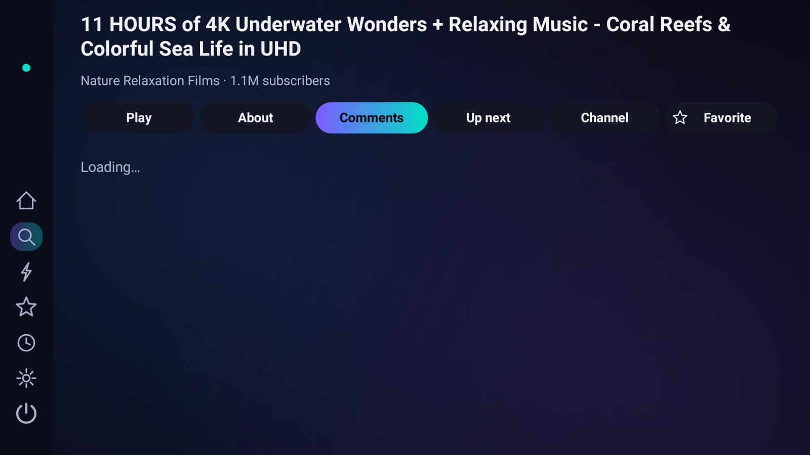 |
| Quality & speed in the player | Details while it plays | Comments with replies |
| 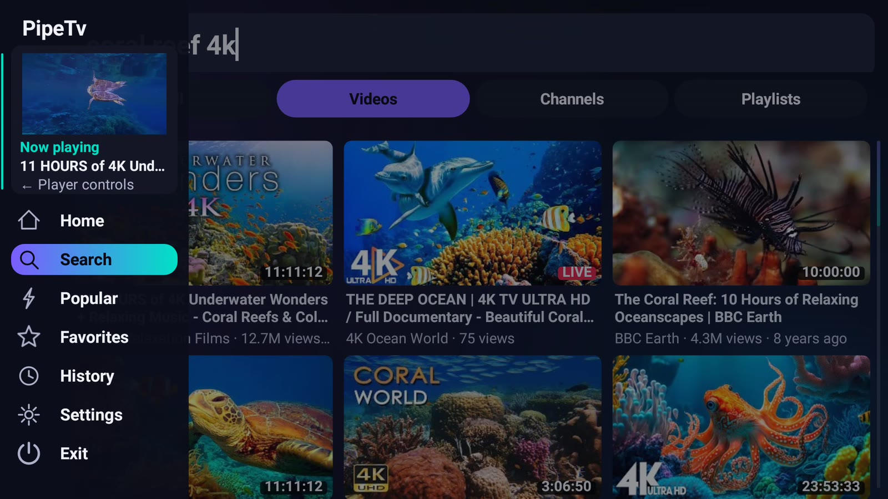 | 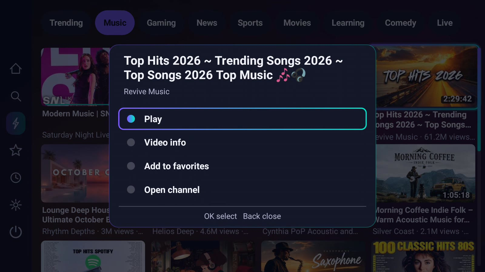 | 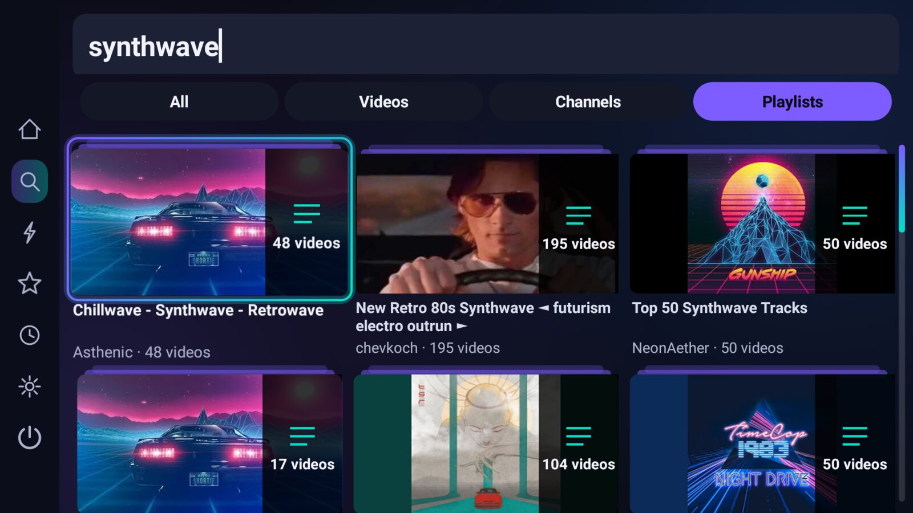 |
| Live mini preview | Hold OK for quick actions | Videos / channels / playlists |
| 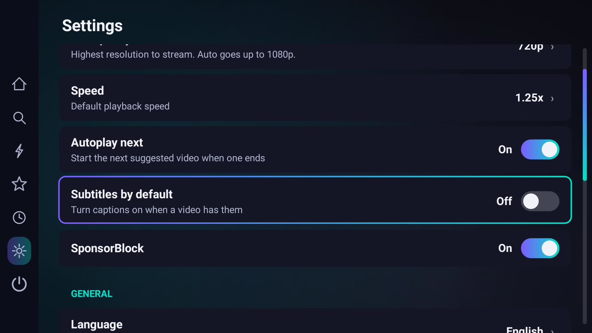 | 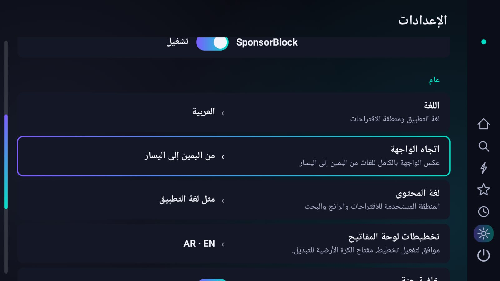 | 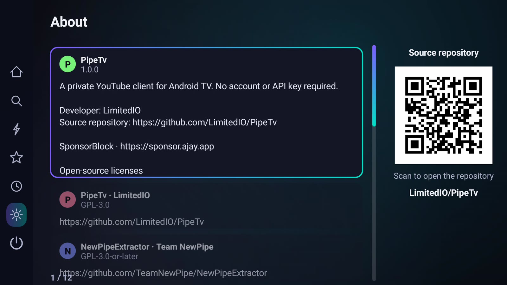 |
| SponsorBlock & settings | 10 languages, full RTL | Open source, repo QR |

<sub>Captured on a 1080p Android TV emulator. More on the [website](https://limitedio.github.io/PipeTv/).</sub>

## Why
- **Instant** – one custom-drawn view tree; the last feed is cached so it shows before the network answers.
- **Smooth everywhere** – virtualised canvas grid, spring physics, thumbnails decoded at card size. Android 5.0+.
- **Keep browsing while watching** – menus overlay the page without resizing it; the main menu shows a live mini preview.
- **Popular** – topic filters: Trending, Music, Gaming, News, Sports, Movies, Learning, Comedy, Live.
- **Recommendations** – built from your watch history, mixed with trending and popular topics.
- **Details** – description, facts, comments, up-next, and a jump to the channel (or playlist) for any video.
- **Smart search** – custom on-screen keyboard (14 layouts incl. Arabic, Russian, Hindi…), live suggestions, recent searches, filters (videos / channels / playlists), endless results and **voice search**.
- **History timeline** – grouped by day with times, progress bars, resume points and one-key removal.
- **Clear controls** – sliders and steppers for quality, speed, volume, subtitles; same widgets in Settings and in the player.
- **Audio & subtitles** – pick the dub/language track or bitrate and any subtitle track, in the player options.
- **Never interrupts** – opening a video keeps the current one playing until the new one is ready, with a clear "Opening…" state and the thumbnail while it loads. Cards look different for videos (with time-ago), channels and playlists.
- **Player menu** – while a video plays, press ← in the main menu to open the larger player panel. An arrow and slim edge line mark its location. Its only button is Close; select the video to return to fullscreen.
- **Quick actions** – hold OK on any card: play, info, favorite, open the uploader's channel. Comments with replies open with OK; Back returns to the list.
- **Mini player** – fast transitions from fullscreen to a live preview, with clear loading, buffering, paused and retrying states in the player panel.
- **SponsorBlock** – silently skips community-marked sections, with color-coded progress-bar marks and one Settings toggle. Segment data: [SponsorBlock](https://sponsor.ajay.app/).
- **Settings that stay focused** – every option opens its own pop-up (list, multi-select or big slider) that captures the keys. Content language is separate from the app language.
- **Layout direction** is left-to-right by default; for Arabic-like languages PipeTv asks whether to mirror the layout (changeable any time in Settings).
- **Favorites** – videos, channels and playlists: red/bookmark key on a card (or the ★ button in details, channel and playlist pages, or `B` in fullscreen).
- **Always plays** – playback retries by itself (lower quality, fresh links, growing pause); the notice disappears the moment it works. Subtitles load on their own and never touch the video.
- **Updates** – checks on launch, downloads new versions automatically, shows progress along the bottom, then offers to install.
- **Alive** – a calm, slowly drifting background tinted per page (switchable in Settings).
- **10 languages** (EN, العربية, ES, FR, DE, RU, TR, PT, हिन्दी, 中文) with full right-to-left mirroring for Arabic.
- **Auto-update** from GitHub Releases · **FOSS**: [NewPipeExtractor](https://github.com/TeamNewPipe/NewPipeExtractor) + [Media3](https://github.com/androidx/media) · GPL-3.0.

## Controls
| Where | Key | Action |
|---|---|---|
| Anywhere | `←` from first column | Open the nav rail (`→` in RTL languages) |
| Nav rail | `↑` `↓` / `→` | Switch page / enter page |
| Grid | arrows, `OK` | Move, play fullscreen |
| Grid | `Menu` / `Info` | Details: about, comments, up next, channel, favorite |
| Grid / details | red or bookmark key | Add / remove favorite |
| Grid → edge | `→` | Focus the docked player (`OK` expands) |
| Fullscreen | `OK` / `Space` / `K` | Play / pause |
| Fullscreen | `←` `→` (hold to speed up) / `J` `L` | Seek 10 → 30 → 60 s |
| Fullscreen | `↑` | Player options: quality, speed, subtitles and audio language (pop-up menus) |
| Fullscreen | `↓` | Video details (player docks, you keep watching) |
| Fullscreen | `0`–`9` / `M` / `Back` | Jump to 0–90 % / mute / minimise |
| Search | mic key, remote voice button | Voice search |
| Search | any physical keyboard | Type directly |
| Anywhere | media keys | Play, pause, next, stop, ffwd, rew |
| Nav rail | `Back` | Close the player, then exit |

## Install & update
Grab the latest `PipeTv-*.apk` from [Releases](../../releases) and sideload it (`adb install`, Downloader, USB).
After that PipeTv updates itself: **Settings → Updates**. Every push to `main` is built and published by CI, and a daily job releases a new build whenever NewPipeExtractor updates.
Works with [Obtainium](https://github.com/ImranR98/Obtainium) too.

## Build
```sh
./gradlew assembleRelease   # needs JDK 17 + Android SDK 35
```

## Code map (every file ≤ 100 lines)
```
i18n/    K (string keys) · S (lookup, RTL) · lang/* (one file per language)
data/    Yt, YtMap, YtPages (extractor) · Feed · Store (timeline) · Prefs · Paged
media/   Engine (ExoPlayer) · Session (resume, subtitles, fallback) · Sources
ui/      Root · Controls/PlayerKeys · Grid · Nav · Hud · Dock · Settings · PlayerMenu
ui/input     Keyboard · Layouts · Voice          ui/search   SearchPage · Chips · SuggestList
ui/detail    DetailsView · ChannelPage · TextList  ui/timeline TimelineView
ui/widgets   Slider / Step / Toggle / Choice rows
update/  Updater · Installer
```
Add a language: new file in `i18n/lang/`, one line in `S.all` (and optionally a keyboard in `Layouts`).

## Support PipeTv
PipeTv is free and always will be. If you'd like to help, tips are welcome:

| | Address |
|---|---|
| **Monero (XMR)** – private, recommended | `49H8xQ538uPf8dwmUCmq9GScNAZhMh6H51TQWTTcY5p4aXdg71z9raG16yGnaU1PGHWDg7doEmR3GfhVEniBMDb88fut64j` |
| **Bitcoin (BTC)** | `bc1qsghvgn84rmkjr3fjgc7gvkt4fqsxde6uk50ave` |

<p> &nbsp; </p>

## Star history
If PipeTv makes your TV nights better, a ★ helps others find it.

<a href="https://star-history.com/#LimitedIO/PipeTv&Date">
 <picture>
  <source media="(prefers-color-scheme: dark)" srcset="https://api.star-history.com/svg?repos=limitedio%2Fpipetv&type=Date&theme=dark">
  
 </picture>
</a>

<sub>Not affiliated with YouTube or Google. Releases are signed with the open key in `keystore/` so updates stay installable; fork and replace it for your own builds.</sub>
